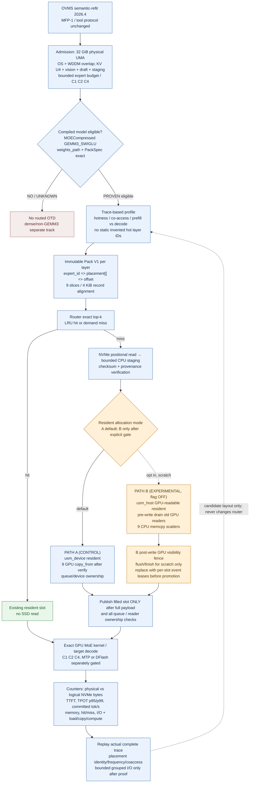

# CIB2 PGP-01: profile-guided MoE pack and memory/physical I/O placement

**Date:** 2026-10-24. **Status:** DESIGN AND IMPLEMENTATION BACKLOG, NOT EXECUTED, NOT RUNTIME ACCEPTED.

**Dependencies:** [CIB2 layer→expert Pack V1 port](LAYER-EXPERT-PACK-IMPLEMENTATION-20261024.md), [real static family map](FAMILY-MAP-20261024.md), [CIB2 replay](../../scripts/cib2/otd_sim/otd_sim.py), [semantic-refit MFP-1](../qwenmonster/OVMS-MODEL-FAMILY-ADAPTATION-PROTOCOL.md). Keep frozen `eb76a74f7aa39573d452d95443e189b1f5f4d9e8` and stock 2026.4/RC1 DLLs untouched.

## 0. Decision

Adopt a **three-axis design**, not a simplistic “hot files vs cold files” partition:

1. **Resident admission:** protect profitable experts in a bounded single-LPDDR GPU-readable resident arena (native LRU baseline).
2. **Physical layout:** order per-layer immutable expert records by measured popularity and co-access, preserving exact `expert_id → placement` mapping.
3. **Request-aware I/O:** first default on-demand one-read-per-missed-expert; compare opportunistic adjacent reads and bounded prefetch only with actual complete, instrumented route traces.

**Phase 1 uses the EXISTING Pack V1 ABI and native one-file-per-layer format; it requires no pack reader/kernel changes.** Pack V1 has `PackLayout::set_placement` and `build_pack(..., placement)`. Phase 2, if profiling proves benefit, can add versioned multi-file shards or inter-layer bundles and async I/O. **Do not build V2 first.**

Physical co-location is not a cache hit. Pack-file sorting without grouped reads/prefetch may provide **little to no decode benefit**. A profile-specific file does not provide extra memory capacity. Pure re-packing cannot reduce the information content of INT4 weights or resident bytes consumed by the same set of experts.

## 1. Confirmed implementation constraints

In `DassaultFalconKing/openvino` Draft PR [#7](https://github.com/DassaultFalconKing/openvino/pull/7), `src/plugins/intel_gpu/src/graph/impls/ocl_v2/moe/moe_otd_pack.{hpp,cpp}`:

- `pack_tensor_count=9`, `pack_alignment=4096`, internal `tensor_alignment=64`; one packed *routed expert* per contiguous record. `record_stride = align_up(payload_layout, 4096)`. Record starts may align to 4 KiB; payload read can be smaller than stride.
- `placement[logical_expert_id] = physical_position` is a permutation; `record_offset(expert)` resolves it. Checksums are indexed by logical expert ID, not physical position.
- `build_pack(dir, spec, source, placement)` can change the physical order without changing logical expert IDs. Build checks reuse and publishes through a temp file/rename; Windows may refuse replacing a file with an open handle. Do not hot-rewrite a live pack.
- `fill_weights_from_pack` currently does `read_verified_record` of exactly one expert payload, then per-slice GPU resident `copy_from`. **It does not issue grouped neighbour reads, nor direct unbuffered NVMe→GPU DMA.**
- Pack V1 per-layer header/placement/checksum metadata is bounded; full-model content-addressing must include checkpoint/export, layer, source layout, quant/packing version and verification receipt. `source_sample_hash` only samples portions of original weights; never treat as cryptographically complete checkpoint identity.
- For a measured old Ornith layer: 256 experts, 1,695,744 byte logical expert payload, 434,118,656-byte pack (8 KiB metadata overhead; subject to exact profile). 40 packs were built. Distinguish measured sizes from unknown sizes on Gemma4/MiniCPM/Qwen3.8/LFM/GLM.

New CIB2 mapper identifies 40 Ornith blocks, 120 routed Const nodes, and 30 Gemma26 blocks, 90 routed Const nodes. Those are **whole tensor Const nodes**, not number of experts and not compiler-validated PackLayerSpec. Expert-axis splitting requires proof of actual compiled GEMM3/GEMM3_SWIGLU/weight offset and kernel quant layout. Gemma26 may use a different kind. Dense E4B has no routed expert Const inventory and cannot use this pack format.

## 2. Storage geometry: three different granularities

Keep these **separate**:

| Granularity | What it controls | Default / experiment |
| --- | --- | --- |
| OS physical/logical sector | Legal offsets, lengths and *buffer addresses* for `FILE_FLAG_NO_BUFFERING` | Query `IOCTL_STORAGE_QUERY_PROPERTY`; not assume always 4096. If not supported, keep existing buffered positional reads. |
| NTFS allocation unit (“cluster”) | How disk blocks are allocated to files, fragmentation and minimum file allocation | Query read-only `fsutil fsinfo ntfsinfo C:` or `GetDiskFreeSpace`. Usually 4 KiB but actual volume may differ. **Never reformat user's disk** just to test 64-KiB clusters. |
| Pack record/layout and I/O extent | What byte range the loader reads per expert and optional adjacent records | Pack V1 record starts 4 KiB-aligned. Test `4K/64K/256K/1MiB` logical group boundaries as **offline candidate layout/prefetch**; do not change physical NTFS cluster size. |

Microsoft documents: https://learn.microsoft.com/en-us/windows/win32/fileio/file-buffering (unbuffered I/O requires sector-multiple offset, size and aligned memory); https://learn.microsoft.com/en-us/windows/win32/api/fileapi/nf-fileapi-getdiskfreespacea (cluster/sector report); https://learn.microsoft.com/en-us/windows-server/storage/file-server/ntfs-overview (NTFS default 4-KiB allocation units and format-time options).

**Crucial:** an expert record ~1.6 MiB already spans hundreds of 4 KiB clusters. Increasing NTFS cluster size to 64 KiB does not turn ~1.6-MiB random reads into a single faster SSD read. That is a separate effect governed by I/O request count, NVMe queue depth, filesystem extents, page cache and controller behavior. SSD erase-block/flash page geometry is not exposed to the application as the NTFS cluster size.

Before testing `FILE_FLAG_NO_BUFFERING` or `OVERLAPPED`, verify payload length and offset multiples, staging buffer alignment, exact kernel-reader semantics and lifetime. A 4096-aligned **record start** alone does not make a non-4096-multiple **payload read** safe for unbuffered I/O. Unbuffered reads bypass OS page cache, which might be desirable for streaming misses or harmful for repeated reuse. Maintain independent buffered control.

Candidate non-destructive operator commands:

```powershell
fsutil fsinfo ntfsinfo C:
fsutil fsinfo sectorinfo C:
Get-Volume -DriveLetter C | Select-Object DriveLetter,FileSystem,AllocationUnitSize
```

Read-only diagnostics; measure on the **actual volume holding packs**. Do not presume `C:` hosts the physical NVMe used by all model files.

## 3. Capture the actual access workload (PGP-00 / PGP-01)

**Inputs must be live complete traces**, not per-model popularity invented from static XML; existing `cib2.otd_sim.v1` is a conservative strict parser but lacks all the phase information for a full speculative/scheduling optimizer.

New versioned `cib2.expert_trace.v2` records, sanitized:

```text
run_id, checkpoint_sha, export_sha, pack_spec_key, quant_profile_sha
compiled_layer_key, logical_layer_id, expert_id, projection_bundle_id
request_hash, slot_id, phase(prefill/decode/draft/verify), iteration, position
topk_rank, route_weight, requested_expert_bytes
resident_before, hit, miss, evicted_expert, lease_group, reader_owner_event
pack_id, physical_record_offset, requested_read_bytes, successful_read_bytes, read_latency_us
read_start_ns, read_end_ns, copy_latency_us, transform_latency_us, queue_depth
accepted_target_tokens, rejected_draft_tokens, actual_committed_tokens
io_source(buffered/unbuffered), cached_origin(known/not_exposed), trace_complete
```

- Distinguish **physical disk** bytes from read() logical bytes. OS file-cache hits are not NVMe reads; collect OS/device counters or mark `NOT_EXPOSED`.
- Separate prefill from plain decode, draft from target verify and rejected speculation. Do not infer target expert demand from drafter.
- Report C1/C2/C4 independently, context length/prefix, prompt family (code/tools/prose/vision) through **non-sensitive labels**. Never capture prompt text, paths or private tensor data in public logs.
- Enforce unique model/graph/quant keys, monotonic clocks, layer scope and exact trace end marker; incomplete traces cannot become placement profiles.
- Bound trace overhead and sampling; perform control A/B `trace=off` vs `trace=on` so telemetry does not itself dominate SSD/CPU.

**Profile shape:** per (`model, compiled_layer_key, expert`) count, byte size, miss count and conditional miss latency, time-decayed popularity, recency, multi-request distribution, access bursts, eviction lifetime, and *co-access/cross-layer temporal transition* graph. Distinguish different applications and use explicit `profile_confidence`. Absent data => identity placement, native LRU and no speculative prefetch.

## 4. Candidate placement algorithm (PGP-02)

### 4.1 Resident value is NOT raw frequency

For expert `e` in layer `l`, estimate the **marginal benefit of pinning** against the existing dynamic LRU, under an exact workload/memory budget:

```text
saved_stall_us(l,e | budget, phase) :=
    counterfactual_misses_avoided_by_pin * measured_critical_path_miss_cost
    - increased_misses_for_other_evicted_experts * their_cost
    - contention/ownership_cost

value_density = saved_stall_us / unique_resident_bytes
```

Use offline replay, not a hardcoded probability formula alone. Costs differ by expert size, layer, sequence phase, concurrent request, and reads hitting Windows page cache. Compute a feasible bounded hot admission only if it outperforms native LRU; otherwise keep default LRU and no pinning.

No hardcoded global “20% hot” independent of KV, vision, drafter or OS budget. One physical 32 GiB LPDDR ledger:

```text
resident_expert_budget <= physical_LPDDR
    - OS/system/driver/safety
    - pinned_model_nonexpert + optional_vision
    - active_KV_U4 + prefix + drafter_weights_and_KV
    - GPU_activation_workspace
    - staging_buffers_and_other_unique_RAM
```

Cache uses **unique physical allocations**; page cache, `usm_host`, staging and GPU-shared memory are not extra tiers. No dual copy of a 1.6 MiB expert without proving value.

### 4.2 File placement score (separate from resident score)

Existing pack V1 retains one logical layer file. For each layer:

1. Build repeated-window **co-access graph** `W[e1,e2]` with bounded lag and conservative correlation correction (common frequency alone is not co-access).
2. Label `hot` (resident-preferred), `warm` (frequent but cache-churned), `cold` (rare/random), with confidence; these are **profile labels**, not distinct allocations.
3. Produce candidate permutations:
   - `identity` baseline;
   - `frequency-order` high-miss/high-read-cost first;
   - `coaccess-cluster` greedy graph ordering with local neighbourhood refinement;
   - `phase-aware` layout weighted by decode/verify workloads and C1/C2/C4.
4. Specify `placement[expert_id]` for `build_pack(..., placement)`, and save separate profile JSON with exact input/source/config/hash, cost weights and optimizer seed.
5. Validate same numerical payload for **every expert** against prior V1, not only sample checks, and independent verifier full pack checksums.
6. Benchmark layouts with **current one-read-per-miss**; expect identical bytes/read counts, because only offsets change. If statistically indistinguishable, don't promote “optimized” ordering.

Graph ordering objective for future *grouped* reads is:

```text
minimise over permutation π:
  Σ observed co-read windows w(i,j) * distance_penalty(|π(i)-π(j)|)
  + λ * expected_extra_prefetch_bytes(π)
  + μ * fragmentation_penalty(π)
subject to one contiguous immutable record per expert and correct logical IDs.
```

Never move a different-layer expert into this layer's V1 without a new loader/manifest. Cross-layer traversal is important for phase-aware scheduling, not evidence that layer files should be merged by default.

### 4.3 Why a “hot file, warm file, cold file” is not automatically optimal

At runtime each layer still computes router top-k and fetches arbitrary logical expert IDs. Splitting file handles or placing hot records at file start does **not** keep them in GPU memory. Potential benefits require measured prefetch or reduced physical fragmentation; costs include metadata, open handles, complicated atomic updates, multiple process lifetime and per-file cluster slack. Start with per-layer files and placement table. Only create a `hot/warm/cold` shard topology after traces demonstrate reduced IOPS/latency under a suitable grouped-read kernel.

## 5. Read and prefetch policy trials (PGP-03)

Baseline: one verified payload read per **demand miss**, CPU checksum, publish resident only after verified copy and correct in-flight-reader ownership.

Candidate grid (independent flags; same profile, model, hardware and seeded workload):

| Candidate | What changes | Critical negative control |
| --- | --- | --- |
| `buffered` native | Windows buffered positional read and normal OS cache | Current verified throughput/latency |
| `buffered+aligned` | placement variation / coaccess neighbours, no additional reads | If no improvement, stop |
| `adjacent-2 / adjacent-4` | coalesced read only when 2/4 *requested* experts' records are physically contiguous and same layer | Never load unrequested experts without separate prefetch accounting |
| `bounded-lookahead` | prefetch at most N records/bytes and deadline before next layer demand, based on **verified** route probabilities | Do not starve target demand, cap waste and p95/p99 |
| `OVERLAPPED/IOCP` | asynchronous bounded queue, 1/2/4 parallel outstanding reads | Correct cancellation, buffer ownership and GPU slot leases |
| `NO_BUFFERING` | separately gated direct file→aligned CPU staging bypassing Windows cache | Correct sector alignment, no regression on warm reads, no “GPU direct DMA” claim |

A 1.6-MiB record already makes 64-KiB chunk grouping only an **alignment/microbenchmark** question; never split every record into dozens of 64-KiB read operations as default. Disk service latency, queue depth, staging cost and verified GPU copy could dominate; measure decomposition first.

If lookahead gets an expert wrong, never change router top-k: ignore the speculation, account wasted bytes and preserve correctness. `target verifier demand > drafter demand > speculative prefetch`, with bounded per-slot I/O and no global finishes in production.

## 6. Pack V2 *only after* objective V1 limitation (PGP-04)

**Adopt a small, versioned manifest and content-addressed immutable generation:**

```text
model-packs/
  manifest.v2.json      # atomically published active generation pointer
  profile-<sha>.json    # immutable sanitized routing profile and quality flags
  generation-<sha>/
    layer-00.pack
    layer-01.pack
    ...
  # Optional future: layer-07-hot.pack, layer-07-cold-00.pack,
  # only if reader handles + V2 sharding measured safe and useful
```

Manifest must bind checkpoint/export SHA, compiled MOE kind, scoped layer ID, nine slice offsets/shape/type/quant, expert count/top-k, pack format, record checksum algorithm, full-file digest, placement permutation/profile SHA and builder version, plus actual storage sector/cluster info as diagnostic metadata (not correctness identity). Device/fs metadata changes should not invalidate the model record layout if otherwise compatible.

V2 additions considered separately: multiple per-layer immutable shards, variable-size records when supported by exact kernel, inter-layer manifest, I/O coalescing, process-restart or stable-handle generation switch, distinct priority prefetched staging. No GPU path changes simply from manifest presence. Old Pack V1 reader/require remains control and fallback (explicit, not silent), no runtime in-place overwrite.

**Quantization changes are NOT “packing”.** INT4/INT8/FP8/MXFP4, mixed-precision gate/up/down, duplicate weights, zstd-compressed cold shards all change kernels, decoder, numerical fidelity or latency. Research independent profile/quant/accuracy stream after deterministic byte-exact packing; do not copy GGUF/Strata mixed quants into OpenVINO IR without re-export + compiled kernel parity.

## 7. How to benchmark on Windows Arc140V

**No filesystem changes, no driver changes, no production services killed, no unbounded re-pack runs.** Capture on actual volume: physical/logical sector, NTFS cluster size, file extent count/fragmentation if safely retrievable (FSCTL_GET_RETRIEVAL_POINTERS), SSD model/driver and throttling, cache policy, available RAM, C1/C2/C4 and WDDM budget. Do not claim internal NAND page/erase-block sizes from OS cluster size.

1. `B0` immutable exact 2026.4 RC1 provenance and stock+native-OTD baseline; plain r0, eligible r20/r40/r75.
2. `B1` identical Pack V1 payload with identity placement, same files/kernel; correctness and profile overhead.
3. `B2` Pack V1 reordered by frequency vs co-access, no other changes. Compare cold/warm TTFT, decode TPS, physical IOPS/bytes, p50/p95/p99 read and TPOT.
4. `B3` if co-access trace shows useful adjacency: request-grouped 2/4 reads vs no group, including concurrency; reject if OS-cache pollution or extra bytes/token offsets savings.
5. `B4` if disk-bound: bounded prefetch and `OVERLAPPED`; if memcpy/USM copy dominates, defer disk layout and compare Path A/B separately.
6. `B5` run 30–60min soak after correctness gates, cache churn, C1/C2/C4 fairness, cancel/load/eviction, startup and cache warmup. No swap storm or GPU resets allowed.

For *every* arm: same source+model+tokenizer+quant+GenAI+driver and data, 1 warmup + >=3 measured repeats for screening, repeats sufficient for confidence intervals to promote; context/prompt families held constant. Distinguish logical requested bytes from physical NVMe bytes. Primary goal: **accepted target tokens per second at bounded p95/p99 and memory**, secondary goals disk bytes per committed token, cache misses/evictions, and startup. Optimizing 4-KiB alignment/fragmentation without end-to-end gain does not justify promotion.

**Invalidating failure gates:** unfinished routing trace, unverified model/quant source, wrong pack placement/record, failed checksum prior to GPU copy, stale handle, lost reader lease, inflated memory ledger, unsupported compiled kernel, broken MFP-1 agentic tool results, Windows memory watchdog stop. A `GPU_COMPILE` success alone never marks `PACK_RUNTIME_PASS`.

## 8. Delegated implementation tickets (independent PRs)

| ID | Engineering ownership | Change location | Exit criteria |
| --- | --- | --- | --- |
| `PGP-00` | disk/geometry profiler | `scripts/cib2/storage_geometry.py` + tests | Read-only NTFS sector/cluster stats, no reformat; missing privileges `NOT_EXPOSED` |
| `PGP-01` | trace/scheduler QA | `scripts/cib2/otd_sim`, new v2 schema and GPU passive tracing in separate OpenVINO fork | Complete actual route traces, budgeted overhead, exact replay, no private prompt |
| `PGP-02` | offline layout optimizer | `scripts/cib2/pack_layout.py`, fixtures/tests; optional actual C++ `placement` builder handoff | Deterministic profile, identity/frequency/coaccess maps; v1 full-payload byte-parity and key isolation |
| `PGP-03` | GPU read specialist | exact RC1-compatible plugin candidate only after baseline/Pack V1 GPU PASS | Grouped reads/prefetch/IOCP behind separate flags, verified leases, demand priority, bounded RAM |
| `PGP-04` | storage architect | versioned v2 manifest/shard specs ONLY if PGP-02/03 measured bottleneck | Reader compatibility, atomic generation, handle pin, independent verifier, recovery negative cases |
| `PGP-05` | integration/bench agent | `docs/cib2` + reproducible Windows runner | A/B C1/C2/C4 under same 2026.4 cohort, cost/benefit and owner-reviewed go/no-go |

**Dependency sequence:** CIB2 P0/P1 compiled OTD → 2026.4 transactional safety → native Pack V1 port+integrity/OVMS CLI → actual live traces → offline layout optimiser → layout-only Pack V1 A/B → grouped-I/O/prefetch → V2 only if justified. PGP-00 and synthetic PGP-02 scaffolding can be built earlier as separate docs/tools without falsely claiming runtime benefit.

## 9. Verdict and first operational handoff

- **Ship first:** existing V1 with default identity placement, correct one-record-per-expert reads, source integrity, best resident budget by real demand; file order remains configurable offline.
- **Experiment next:** profile-derived per-layer `placement`, replay and end-to-end A/B, plus geometry measurement. No NAND-page folklore and no reformatting.
- **Only if justified:** grouped I/O, asynchronous prefetch or profile-keyed immutable V2 shards.
- **Never mix:** sparse routed expert packing with arbitrary dense layer checkpoint sharding/CPU–GPU layer placement; dense layers need their own graph-level operator/activation boundary gate and file layout.

Next local agent should start at **PGP-00** and **PGP-02 dry-run** while other agents finish native RC1 Pack V1 and compiled eligibility. The user may keep normal serving while these read-only tasks run. GPU memory and I/O experiments must be serialized with the owner-authorized hardware test slot.

**This spec is a design proposal, not a claim that hot/cold expert ordering, clustered reads or V2 shards are implemented.**


## 10. Whole-model file organization: non-expert layers are not OTD expert records

The requested long-term goal is **all model components**, but a native OpenVINO IR `openvino_language_model.bin` has Const offsets recorded in its XML graph. **Do not reorder or split that original .bin and leave the IR unmodified:** the compiled model would read the wrong byte ranges. Pack V1 sidecar is consumed only through the eligible MoE routed-expert provider. For dense/attention/vision, file organization needs its **own** importer/exporter or supported graph-level model-loading route and is intentionally a later gate.

Proposed logical manifest and *conditional* future physical organization:

| Component role in static CIB2 mapper | Natural access pattern | Runtime residency | Possible future file strategy |
| --- | --- | --- | --- |
| Embeddings, output head, norms, router, attention, shared/dense blocks | required each generated token | resident and source-pinned | keep original IR/`.bin` now; future immutable `core` segments only with exporter+IR offset rewrite and exact logits parity |
| MoE routed `gate/up/down` weights+scales+ZP | conditional by router, per layer and token | bounded LRU or profile-admitted hot | **current Pack V1 per compiled layer** with logical-to-physical placement; optional future shards after measured clustered-read win |
| Vision encoder and image merger | required only for image/video turns, may run once per visual input | compiled separate IR graphs or model-specific pipeline; conditional load only if GenAI supports it | potential `vision` file group and unload after prefill, **not** speculative unsupported dynamic unload of GPU compiled graphs |
| Draft/MTP/EAGLE/DFlash head | used only in compatible speculative mode | separate weights/KV/headroom with its own source/quant identity | `draft` file group or existing draft IR; separate checkpoint from target; no cross-model expert-ID reuse |
| KV U4, prefix/cache, state/activations | dynamic request and model state | RAM/USM runtime-owned | **not immutable weight pack files**; ordinary persistent prefix cache has separate privacy/invalidation gates |
| Dense E4B or non-GEMM3 MoE layers | may be always-used even when weights are huge | CPU/GPU execution partition must be graph-and-kernel proven | optional layer-level immutable segments / supported HETERO+exporter after full architecture-specific feasibility gate |

Illustrative *logical* organization, not current accepted on-disk layout:

```text
model-identity-<sha>/
  manifest.json
  original-ir/          # canonical exported XML+BIN remain unchanged
  routed-packs-v1/      # existing compiled GEMM3 expert-provider sidecars
    layer-00-<key>.pack
    layer-01-<key>.pack
  placement-profiles/   # versioned derived statistics and expert permutations
    workload-<sha>.json
  future-optional/
    core/               # ONLY if exporter rewrites/validates IR Const maps
    vision/             # ONLY if pipeline supports load/unload independently
    draft/              # optional mode and separately pinned artifact
    shards-v2/          # ONLY if grouped/async reader exists
```

**Never partition original weights into “hot/cold” physically unless the corresponding OpenVINO loader understands the new offsets.** For fixed layers executed each token, “cold” is normally a workload/conditional-component property (e.g. image branch absent from text requests), not popularity of a routed expert. File layout and quantization cannot substitute for proper compute placement and memory admission. Cross-layer adjacent physical storage is only an optional launch/read-ahead experiment, not a supported inference pager.

This keeps the **unified model component manifest** useful immediately for measurements while leaving the proven expert V1 and canonical IR untouched.


## 11. UMA Path A / optional Path B: placement controller integrated with PGP (2026-10-24)

**New canonical architecture drawing:** [PGP-UMA-PATH-AB-20261024.mermaid](PGP-UMA-PATH-AB-20261024.mermaid). Its solid Path A is the **unchanged default control**; dotted Path B is an experimental, opt-in memory strategy. This extends, rather than replaces, the native disk Pack V1 / expert placement work. The authoritative earlier design/evidence lives in [ADR-UMA-01, §§4–11](https://github.com/DassaultFalconKing/gemmamonster_model_server_OVMS/blob/docs/adr-uma-arc140v-shared-memory-20261022/docs/qwenmonster/ADR-UMA-ARC140V-MEMORY-MODEL-20261022.md) and [OpenVINO Draft PR #8](https://github.com/DassaultFalconKing/openvino/pull/8); these are independent branches, not silently merged code.

### Path A/B memory controller flow (rendered diagram)



### 11.1 Two real datapaths, one pack format, one physical LPDDR pool

| Step | A — production-control target, §usm_device§ | B — experiment only, §OTD_RESIDENT_USM_HOST=1§ |
| --- | --- | --- |
| Disk | Positional read one exact native Pack V1 record from NVMe into CPU staging | **Same** read into CPU staging; not a disk-to-GPU zero-copy path |
| Before write | Follow queue/device copy ordering; do not evict in-flight readers | Explicitly **finish all registered streams whose GPU kernels may still read a recycled slot before any CPU scatter** |
| Verification | Same-handle source pin, layer/quant/placement bounds, full record checksum **before slot update** | Exactly the same, never trust a merely sampled source ID |
| Residency | Allocate GPU-owned §usm_device§ routed resident | Allocate GPU-readable/CPU-writable §usm_host§ routed resident; still uses same physical LPDDR |
| Fill | Nine logical §copy_from§ for weight/scale/ZP slices | Nine CPU §memcpy§ scatters from verified staging; **not** nine disk reads |
| Visibility | Device queue completion/ordering per exact RC1 API | **After** scatter, explicit GPU visibility §flush/finish§ before any publish |
| Publish | Atomically set filled only once entire payload and reader lease ordering are valid | Same; never publish stale, partially overwritten or wrong-mode slot |
| On cache hit | Native resident GPU kernel | GPU reads host-allocated residency; kernel cost must be measured, not assumed same as A |
| On error/cancel | No false hit, no copy after lifetime ends, bounded cleanup | Same + cross-stream no-use-after-overwrite; B disabled and fail closed on missing lease/fence evidence |

The old scratch correctness proof used global §stream.finish()§. That is suitable for isolated safety trials but **not** an accepted scalable per-slot ownership mechanism. Before production promotion define request/stream-aware per-slot **reader events/lease counts**, explicit pre-write wait and post-write visibility, correct cancellation and multi-slot/concurrent MTP verifier state. Never remove the pre-write barrier and keep only the post-write fence: the earlier implementation had that race.

**B is not another memory tier**. Both §usm_device§ and §usm_host§ allocate pages in the single 32 GiB LPDDR pool on Core Ultra 258V; WDDM ≈27.5 GiB reported GPU budget cannot be added to system RAM. Path B can reduce GPU copy overhead on cold misses but can worsen steady GPU GEMV/compute and severely delay startup.

### 11.2 Local measured evidence and why there is no automatic B promotion

Provenance: [P0-B Phases 4–5 verdict](https://github.com/DassaultFalconKing/openvino/blob/scratch/uma-02-host-harness-20261022/docs/coordination/acceptance/P0B-PHASE45-20261022/VERDICT.md), **2026.5-derived scratch cohort** on Arc 140V; **not** full/identical §2026.4.0.0rc1§ acceptance:

| Metric | A | B | Interpretation |
| --- | ---: | ---: | --- |
| 1,695,744-byte expert cold p50 | 3.1876 ms | 2.5149 ms | B about 21% faster on this isolated cold miss |
| Fill/copy p50 | 612.1 µs | 93.0 µs | B cheaper in measured resident fill |
| GEMV, M=1 p50 | 46.5 µs | 53.8 µs | **B ~15.7% slower** on single-token kernel |
| Short Ornith model ready @ ratio20 | ~42 s | ~283 s | B severe startup regression in this cohort |
| Short OVMS C1/C2/C4 | PASS | PASS | Small model/slot slice only; no soak, no production correctness or overall throughput verdict |

A cold-miss gain is not evidence that B improves accepted target tok/s; no evidence supports universally allocating §usm_host§, or that it shrinks the resident working set. Selection is gated first by reproducible **same 2026.4 source/IR/quant/kernel/driver** A/B and by *startup*, *steady GEMV*, *token throughput*, *TPOT p95/p99*, *WDDM memory* and *concurrent reader lifetime*.

### 11.3 Controller and cost model: pack ordering independent from allocation mode

Decision state for a compiled routed layer/expert-cache arena:

§§§text
model/quant/IR lock
  → compiled OTD eligible + immutable verified Pack V1
  → ONE UMA resource ledger + C1/C2/C4 admission
  → physical file placement (identity | frequency | coaccess; offline)
  → resident allocation mode (A default; B opt-in scratch with matching ABI)
  → native exact router top-k / LRU demand miss
  → verified record staged once
  → safe write, visibility and publish by chosen mode
  → GPU kernel / accepted target token / trace
§§§

- Pack physical placement answers **where on SSD**; A/B answers **how a verified byte record becomes GPU-readable resident state**. They should be measured as separate factors: §pack_layout × memory_mode × offload_ratio × C1/C2/C4 × phase§. Never infer correlated gain from comparing different checkpoint/layouts.
- A mode switch must **not reinterpret existing slot pointers**. A and B arena storage types/allocators are different. The scratch implementation selects B with a **global opt-in flag** at allocation time. Per-expert or per-layer adaptive A/B is **research only**: requires distinct typed arenas, typed slot leases and explicit data migration/rebuild with complete memory accounting. Never hot-flip a live slot's type.
- If future mixed A/B arenas exist, the cache identity and trace must include §checkpoint / scoped_layer / expert / quant_profile / pack_version / resident_mode / allocation_generation§ as appropriate. Logical expert identity is independent of physical residency, so no false cache hit may arise from a mode key change.
- For decision-making, compare §expected saved cold-stall along target critical path§ against §steady GPU compute penalty × actual reuse§, extra synchronization, startup cost, and resident RAM overhead; measure conditional by request phase, not using a single hotness threshold.
- B should not be automatically equated to “cold”: a rare expert can be a transient miss in the same A arena. Real hot experts often spend more time in GEMV than in fill, suggesting A may remain preferable for those workloads, but this is a **hypothesis** until same-run data.
- Modes §auto§ and §hybrid§ should **not** be advertised to users until an actual safe runtime allocator/lease controller is implemented and benchmarked. Only §A§ and explicit global experimental §B§ may be tested initially, never silently switched.

### 11.4 Unified memory admission and eviction contracts

§§§text
B_expert_resident_available = max(0,
  min(system_available_after_OS_reserve, WDDM_budget_minus_usage_after_GPU_reserve)
  - incremental_unique_KV_U4_draft_vision_activation_staging_demand)
§§§

This is an **admission heuristic**, not an equation claiming both reported counters measure identical allocations or independently additive capacities. Prefer measured unique physical allocations/commit deltas and conservative headroom; report §NOT_EXPOSED§ for unknown budgets. The two constraints overlap; do not sum their free bytes. Track §GPU_BUDGET, GPU_CURRENT_USAGE, system_available, hard_faults, private_commit, per-mode resident allocations, pinned/core, OS page cache§ and actual queue occupancy.

- Define fixed non-expert weights/router/attention/vision obligations, active prefix and KV U4 per slot, speculative draft weights+KV, activation workspaces, pack staging, OS/driver/UI safety, and bounded expert arena.
- Keep a single budget for A+B. If §usm_host§ and §usm_device§ arenas coexist in a future trial, count both **unique** physical page ranges and migration peak; do not double count merely aliased host/device views; do not silently duplicate all hot experts in both arenas.
- On pressure: stop/reduce speculative prefetch → reduce candidate draft window or slots if allowed → shrink future expert arena at safe lease points → run supported plain fallback or refuse admission. **Never** evict a live reader, silently lower quantization, swap storm, or kill the desktop.
- Cache hit invalidation includes model/quant/pack generation/allocator mode and completed stream reader lifetimes. A resident prefetch or B fill has no executable effect until both exact bytes and visibility are proved.
- Startup allocation order matters: measure §model_ready§, cold pack build and cold first request independently; a B performance boost on 1.6-MiB miss cannot justify a 6.7× model-start regression without an explicit amortization proof.

### 11.5 Phase-aware profiling and test matrix addition

Extend §cib2.expert_trace.v2§ (section 3) with §resident_mode, resident_arena_id, arena_generation, allocated_unique_bytes, staging_peak_bytes, slot_owner_stream_ids, prewrite_wait_us, scatter_or_copy_us, postwrite_visibility_us, copy_queue_stall_us, kernel_gemm_m, residency_hold_tokens, accepted_target_tokens§. Never expose raw prompts or private paths.

Run **4 distinct controls** once 2026.4 Pack V1/GPU correctness PASS:

| Arm | Pack layout | Resident mode | Question |
| --- | --- | --- | --- |
| A0 | identity Pack V1 | §usm_device§ | Canonical performance and safety control |
| A1 | profile-optimized Pack V1 | §usm_device§ | Does physical placement alone help without grouped reads? |
| B0 | identity Pack V1 | §usm_host§ explicit opt-in | Are B cold gains worth startup/steady/memory cost? |
| B1 | profile-optimized Pack V1 | §usm_host§ explicit opt-in | Does placement interact with B enough to justify complexity? |

Each: exact source/build/DLL identities, LRU cold/warm, 20/40/75 only if compiled eligibility, 512/2048 prefill and 8K+ by admission, Qwen/Ornith agentic loop + Gemma regression control, C1/C2/C4, tool/reasoning SSE/unary parity, error/cancel and same-slot/two-queue ownership, GPU numerical/logits parity. One warmup + ≥3 measured paired samples for screening; repeat for confidence and soak only after local correctness. For B record both prewrite drain and visibility, not just total copy. If packed layout / B mode makes startup, p95/p99, memory or M=1 unacceptable, **reject that arm** even if cold p50 improved.

### 11.6 Atomic implementation tickets and promotion order

| Ticket | Work | Dependency / PASS gate |
| --- | --- | --- |
| §UMA-PGP-00§ | Read-only unified LPDDR/WDDM accounting + disk/sector and unique allocations, Windows process attribution; short provenance snapshots | Starts now; no production changes, unknowns §NOT_EXPOSED§ |
| §UMA-PGP-01§ | Extend profiler/trace v2 and offline replay for A/B copy, lifetime, phase and actual physical I/O | After passive trace gated; exact event sequence + overhead control |
| §UMA-PGP-02§ | A-only verified Pack V1 memory correctness + placement A0/A1 and no-copy-on-corrupt tests | Native §2026.4rc1§ Pack V1 / semantics accepted |
| §UMA-PGP-03§ | Port scratch B with **pre-write** ownership and **post-write** visibility to **isolated compatible 2026.4** branch, global opt-in only; no unproven per-expert hybrid | Model identity + compiled kernel; reader overlap, C1/C2/C4, error/cancel/eviction GPU tests |
| §UMA-PGP-04§ | Full A0/A1/B0/B1 matched benchmark and memory admission controller; audit cold read, GEMV, startup and 1–4 slots | Same runtime ABI and exact source; B remain OFF if any critical regression |
| §UMA-PGP-05§ | Optional typed per-layer/per-slot A/B allocator + event/lease ownership, per-mode cache key, rollback/transition and bounded admission | **Research only after B0 useful**; no global §finish()§ per miss in promoted runtime |
| §UMA-PGP-06§ | Bring into OVMS semantic-refit as explicit operator flag only after independent QA+owner approval | Full regression and owner signoff; no default B and no silent fallback |

**Priority:** ship native A Pack V1 + profile optimizer/trace first. B stays behind §OTD_RESIDENT_USM_HOST=1§ and is an *independent* measured memory-path experiment. Do not introduce Path B into a hot/cold-file sharding PR; one mechanism per independently reversible commit.
