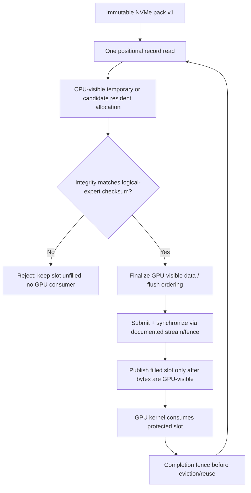

# ADR-UMA-01 — Единая физическая LPDDR и CPU↔GPU sharing в GEMMAMONSTER

**Дата:** 2026-10-22  
**Статус:** `PROPOSED / EVIDENCE_REQUIRED`; research-only, без runtime merge  
**Целевая платформа:** Windows 11, Intel Core Ultra 258V / Arc 140V, 32 GiB unified system memory  
**Source lock OpenVINO GPU:** `DassaultFalconKing/openvino` / `research/ov-gpu-otd-cohort-b5bfb148` @ `479219245f6f10b670367ad35af16513d72d2091`  
**OVMS integration lock:** `DassaultFalconKing/gemmamonster_model_server_OVMS` / `integration/qwm01-otd-pack-20261022` @ `746dc833dc3bcccf64fabdb469feda9260582bae`  
**C6 golden:** `ba6ec792c3121850fea167fa7d7e190b25fcdc76` — READ ONLY.

## 1. Решение

**Считать LPDDR на 258V одним физическим ресурсом**, а не складывать «CPU RAM + GPU VRAM» как две независимые ёмкости. **Не** объявлять автоматически единую виртуальную адресацию, coherent sharing, zero-copy или одинаковую скорость доступа. Разделить модель на три независимые оси:

1. `residency_hotness`: насколько часто `(layer,expert)` нужен и должен оставаться GPU-readable;
2. `precision_hotness`: какие матрицы/слои требуют более высокой точности;
3. `memory_access_policy`: `GPU-only/device-preferred`, `CPU-visible GPU-readable`, `file-backed`, `temporary staging`; сюда же относятся владельцы, синхронизация, copy count и возможность aliasing.

Архитектура по умолчанию: **fixed model + MTP/drafter + KV U4 → protected**, routed experts → **единый bounded resident set**, NVMe → **только cold backing**, staging → **малый временный буфер**. Не добавлять большой pinned-RAM warm tier рядом с «GPU VRAM» на этом UMA-хосте. На discrete GPU это отдельное решение, а не универсальный запрет host cache.

**Потенциальное улучшение:** `NVMe → CPU-visible/GPU-readable resident allocation → GPU consumer`, без отдельного `host staging → GPU resident copy`. Это пока **исследовательский path**, не замена принятому OTD. Возможность устранять копирование должна доказать совместимость аллокаций и layout девяти tensor views, а не только факт `UMA=true`.

## 2. Что известно, а что пока нет

| Вопрос | Уровень доказательства | Вывод |
|---|---|---|
| 258V/Arc 140V имеет общую LPDDR для CPU+iGPU | аппаратная топология; пользовательский research | физический пул один; конкурируют за DRAM bandwidth |
| `D3D12_FEATURE_ARCHITECTURE1.UMA` на конкретном драйвере | **НЕ ИЗМЕРЕНО** | проверить на Windows, не угадывать по имени GPU |
| `CacheCoherentUMA` на конкретном драйвере | **НЕ ИЗМЕРЕНО** | coherence нельзя вывести из UMA |
| OpenCL SVM/Intel USM capabilities и фактический GPU allocator | **НЕ ИЗМЕРЕНО** | определить runtime API, тип allocations и access flags |
| GPU budgets / «27.5 GiB» | значение из текущей эксплуатации; точная семантика **НЕ УСТАНОВЛЕНА** | это может быть WDDM budget, application setting или reported usable allocation, а не физическая «стенка» |
| GPU Remote Tensor `CPU_VA`, `MMAPED_FILE`, USM | **API DOCUMENTED** в OpenVINO 2026 | публичные external tensor wrappers существуют; применимость к internal MoE resident tensors **не доказана** |
| Native OTD baseline | **SOURCE CONFIRMED** | `pack_reader.read(staging)` → девять `mem->copy_from(..., slot*size, ..., true)` |
| Экономия от zero-copy для MoE | **НЕ ИЗМЕРЕНО** | memory mapping может уступить device-preferred buffers в effective GPU bandwidth |

Microsoft прямо требует различать `UMA` и `CacheCoherentUMA`, а также оценивать residency budget, а не трактовать Shared GPU Memory как уже отнятую RAM. В Windows WDDM выполняет virtual-memory/residency management, но физическое совместное использование не отменяет CPU/GPU ordering, fences и cache-visibility requirements.

## 3. Проверенный OpenVINO путь, который нельзя ломать

Код в закреплённой OpenVINO ветке:

- `src/plugins/intel_gpu/src/graph/impls/ocl_v2/moe/moe_otd_runtime.cpp::fill_weights_from_pack` делает один positional read полного contiguous expert payload в reusable `std::vector<uint8_t> staging`;
- далее по одному `cldnn::memory::copy_from` для каждого из девяти логических tensor slots (`gate/up/down` × `weight/scale/zp`), пропуская отсутствующие;
- `expert_weight_providers.cpp::acquire_slot` выбирает resident slot и вызывает fill перед `LRUCache::set_filled`;
- CLD-01/#1 добавляет checksum **до** GPU copy, CLD-01B/#4 связывает метаданные с фактическим handle; CLD-02/#2 защищает publication; CLD-03/#3+#5 защищают attribution и replay.

Важно: **одна позиционная операция чтения ≠ отсутствие последующих копий в LPDDR**. `copy_from` может применять host memcpy, GPU DMA/queue transfer или промежуточную staging strategy в зависимости от allocator/backend. Не приписывать ей точную цену и физическую топологию без профилирования.

**Layout obstacle:** pack v1 хранит `expert-major` contiguous запись с nine slices, а resident memory представлена девятью tensor allocations и слотами `slot*per_expert_size`. Чтобы загрузить одну expert record непосредственно в существующие девять buffers, потребуется scatter либо kernel/layout изменение. Простой `mmap(pack)` или USM shared pointer **не создаёт автоматически девять корректных GPU views**. Ни packet v1, ни kernel view-layout изменять в первой экспериментальной итерации нельзя.

## 4. Варианты data path: только A принят как контроль

| Path | Данные и владение | Потенциальный выигрыш | Обязательные риски/гейт |
|---|---|---|---|
| **A. Baseline** | positional NVMe read → CPU staging → FNV verify → nine GPU resident copies → publish slot | известная корректность/откат | сохранить как control, `require` fail closed |
| **B. Direct resident fill** | GPU-readable CPU-visible fixed residency allocation; one read into permitted region → verify → fence → publish | исключить staging→resident copy / снизить временную duplication | API allocation, byte layout, 9 views, checksum before publication, no unverified GPU access, fences; отдельный prototype |
| **C. Read-only mapped cold record** | immutable pack mapping `CPU_VA`/`MMAPED_FILE` → GPU reads mapped slices without cache admission | обход выделенного resident slot для редких cold experts | random page faults, 4K/file offset/cacheline alignment, lifetimes, Windows file replacement, unpredictable physical disk traffic, nine tensor views; **не production** |
| **D. CPU cold-expert lane** | CPU computes selected expert from staging while GPU handles hot experts | overlap memory stalls | LPDDR bandwidth contention, AVX compute vs GPU, numerical parity; separate gate after A/B |

**B и C не эквивалентны.** B использует управляемую GPU-readable allocation как resident cache с явным admission; C использует file-backed bytes и OS paging как upstream source. Не выдавать C за «бесплатный 32-ГБ GPU cache» и не скрывать недетерминированные NVMe page faults за memory mapping.

Верхнеуровневые `ov::RemoteTensor` CPU_VA/file APIs документированы преимущественно для входных/выходных тензоров; они не доказывают, что внутренние `cldnn::moe_weights` могут оборачиваться без изменений MoE kernel, graph compilation, layout и lifetime. Переиспользование API возможно только после source-level mapping от remote tensor к внутренним memory objects.

## 5. Состояния, lifetime и synchronization



`FREE → RESERVED → LOADING → VERIFIED → GPU_VISIBLE → IN_USE → RECLAIMABLE` (proposed conceptual state model; **not** an existing LRU implementation API). No intermediate state may become a resident `hit`. On error the slot stays unfilled. Concurrency: staging/slot ownership must be scoped to one writer, protected against simultaneous request races; do not extrapolate present provider thread-safety from process-global counters.

**Security/correctness:** FNV-1a is accidental corruption detection, not a security MAC. A shared/mapped buffer must not be modified in place while in use; checksum-then-mutate races still exist if a separate actor writes into the same memory. A file replacement must not cause a lazy-reader snapshot mismatch; preserve CLD-01B pinning and CLD-02 atomic publish contracts. Never allow a file-backed mapping to bypass required pack verification.

## 6. Resource budget: одна память, два ограничителя

Use *available dynamic headroom*, not `RAM + reported VRAM`:

```text
System memory availability / commit headroom
    ├─ OS, other applications, CPU-side runtime
    ├─ model fixed buffers, CPU caches, transient I/O
    └─ shared physical LPDDR (also used by Arc 140V)

WDDM GPU LOCAL budget and CurrentUsage (on UMA: budget within the SAME physical pool)
    ├─ fixed weights, routers, shared experts, attention, native MTP/drafter
    ├─ KV U4 × active sequences / C1-C2-C4 / context growth
    ├─ activation/workspace/driver reserve
    ├─ routed expert resident allocations
    └─ scratch, DMA/staging or GPU-visible host regions
```

For allocation admission, both `system headroom` **and** WDDM `Budget - CurrentUsage` constrain growth, but they are **overlapping constraints**, not capacities to add. Hold a safety reserve for Windows/driver/UI, allow expert cache to shrink when KV/C4 pressure grows, and never make cache adaptation contingent on unproven static `27.5 GiB` carve-outs. Record private memory/commit, working set, GPU budget/usage, hard page faults, OS disk activity and LPDDR/CPU/GPU contention side by side.

Physical expert bytes read from NVMe **cannot** be inferred from logical pack bytes, mmap faults or OpenVINO trace counts. Demand a device-level Windows counter plus sample-window identity. File-cache hits are not physical NVMe reads.

## 7. Model-level policy impact

| Model | First change? | Architectural target |
|---|---|---|
| **Gemma 4 26B-A4B** | observation only | keep near-full routed residency where memory permits; preserve C6 quality, tool loops, shared experts and long C4 KV |
| **Qwen3.6-35B-A3B** | prioritize capability + A/B | likely strongest benchmark of shared allocation vs current staging/copy, under MTP/DFlash and C1/C2/C4 pressure |
| **Qwen3.8-Flash-Next** | treat as cold-tail stress | large routed pool/PLE row storage remains separate; only after correctness evidence evaluate C mapped cold access against B bounded resident cache |

Original hot-set counts and offload ratios are research starting points, not ground truth. Do not introduce fixed per-layer IDs or scheduler before real eligible routing traces. Precision-hotness remains separate from memory-access policy; a more precise expert is not automatically hotter in residency.

## 8. Windows-only evidence gates (new subtrack `UMA-00..03`)

| Gate | Owner | Required evidence before next stage |
|---|---|---|
| `UMA-00` topology | diagnostic-only Windows agent | OS/version, Intel driver/WDDM, D3D12 `UMA` and `CacheCoherentUMA`, DXGI LOCAL/NON_LOCAL budgets, CPU available/commit, true GPU device matched by LUID/adapter ID, OpenCL SVM/USM capability; explain the `27.5 GiB` control |
| `UMA-01` native allocator | C++/OpenVINO agent | record memory allocation types backing the *nine resident MoE tensors*, CPU visibility, alignment/layout, `copy_from` real backend path, page pinning/ownership; explicit feasibility verdict for B/C |
| `UMA-02` isolated experiment | test agent after local build gates | **separate experimental branch**, leave A untouched; one real 4K-aligned pack read, verify before GPU access, correct tensor view/layout, deterministic fence tests and negative corruption cases |
| `UMA-03` performance & integration | operator-approved GPU run | end-to-end throughput, p95/p99 TPOT, OTD miss wall time, bytes copied/committed token, physical NVMe bytes, WDDM pressure, hard faults, memory peak, no logits regression; compare A vs B vs (if approved) C |

`UMA-00` may run host-only and read-only, subject to current resource policy. `UMA-01` is code inspection and native test preparation. `UMA-02/03` **must not** run during GPU-compute pause and require all current Wave-01 Windows correctness gates to pass. Linux: `DEFERRED_NO_MACHINE`. A D3D12 adapter capability **does not** prove OpenCL/SVM capabilities or actual memory sharing in the GPU plugin.

Decision criteria for path B: maintain exactly one positional payload read/miss, pack v1, fail-closed required mode, no unchecked byte consumed, no CUDA/driver hacks; prove zero additional copy or materially fewer copied bytes **using measurements**, while maintaining or improving end-to-end performance under same IR/quant/draft/driver. If any required capability is absent or GPU read bandwidth collapses, keep path A.

## 9. Relationship to existing PRs and non-goals

Existing cloud Windows integration work remains the gate: OpenVINO Draft [#1 integrity](https://github.com/DassaultFalconKing/openvino/pull/1), [#4 reader pin](https://github.com/DassaultFalconKing/openvino/pull/4), [#2 publication](https://github.com/DassaultFalconKing/openvino/pull/2), [#3 telemetry](https://github.com/DassaultFalconKing/openvino/pull/3), [#5 policy evidence](https://github.com/DassaultFalconKing/openvino/pull/5) and [#6 independent verifier](https://github.com/DassaultFalconKing/openvino/pull/6). **No code change in this ADR, no automatic merge, no retroactive acceptance**. Avoid altering current tests while a local agent is assembling Windows integration. New feature flags and C++ allocator interfaces require separate design/PR after `UMA-01` evidence, not speculative API shapes fabricated now.

Not authorized: CLD-04 scheduler, prefetch/paging runtime, `mmap` default flips, global BIOS/DVMT changes, arbitrary `27.5 GiB` reserved allocation, cache flush bypass, CPU/GPU simultaneously writing a record, new large RAM tier, KV U4 changes, precision profile changes or production routing policies. No Linux machine in current test wave.

## 10. Reference material and evidence provenance

1. User-supplied 2026-10-22 report **«Совместное использование unified/shared системной памяти между CPU и GPU в Windows»**, 769 lines. Source of conceptual distinction: physical page, VA, coherency, budgets; its general statements are not per-machine capability measurements.
2. Microsoft Direct3D 12 UMA/CacheCoherentUMA discussion: <https://learn.microsoft.com/en-us/windows/win32/api/d3d12/ns-d3d12-d3d12_feature_data_architecture> and modern `D3D12_FEATURE_DATA_ARCHITECTURE1`; official architecture semantics: <https://microsoft.github.io/DirectX-Specs/d3d/ResourceHeaps.html>.
3. OpenVINO 2026 GPU OpenCL remote-memory capabilities including `CPU_VA` and `MMAPED_FILE`: <https://docs.openvino.ai/2026/api/c_cpp_api/group__ov__runtime__ocl__gpu__cpp__api.html>.
4. GPU Remote Tensor CPU pointer / file-backed mapping conditions (alignment, lifetime, READ mode): <https://docs.openvino.ai/nightly/openvino-workflow/running-inference/inference-devices-and-modes/gpu-device/remote-tensor-api-gpu-plugin.html>.
5. GPU code reference: <https://github.com/DassaultFalconKing/openvino/blob/479219245f6f10b670367ad35af16513d72d2091/src/plugins/intel_gpu/src/graph/impls/ocl_v2/moe/moe_otd_runtime.cpp>, `fill_weights_from_pack()`; <https://github.com/DassaultFalconKing/openvino/blob/479219245f6f10b670367ad35af16513d72d2091/src/plugins/intel_gpu/src/graph/impls/ocl_v2/moe/expert_weight_providers.cpp>, `acquire_slot()`.
6. Existing model-specific hotness/precision plan: `docs/qwenmonster/HOT_COLD_EXPERTS_ARCHITECTURE.md` on pinned OVMS integration.

**Status summary:** This ADR changes the architecture **hypotheses, evidence requirements and experiment ordering only**. It does **not** claim that zero-copy is possible for existing OTD tensors or that a 27.5-GiB GPU cap is a carved-out physical region. Keep the verified native OTD path as baseline until local results prove otherwise.


## 11. Addendum 2026-10-23: measured UMA Path A/B and CIB2 decision

**Status: measured on 2026.5 scratch GPU cohort; NOT portable runtime acceptance for RC3B 2026.4.** Earlier research-only sections 1–10 were written before UMA-00/02 and P0-B tests. Preserve them as historical hypotheses; use this addendum for updated evidence.

### 11.1 Tested implementations (not equivalent to theoretical zero-copy)

| Path | Actual data flow | Resident type | Default |
| --- | --- | --- | --- |
| A, control | NVMe pack positional read -> CPU staging -> verify -> up to nine GPU copy_from calls -> publish LRU slot | usm_device / preferred | on |
| B, scratch | NVMe pack positional read -> same staging -> verify -> drain in-flight GPU readers **before writes** -> nine CPU scatters -> post-write visibility fence -> publish | usm_host, GPU-readable | off; OTD_RESIDENT_USM_HOST=1 |

Path B eliminates a separate staging-to-device copy path, **not** the staging buffer, CPU scatter, pack verification, or nine logical slices. It is not NVMe-to-final-resident zero-copy. Both live within the same physical 32 GiB LPDDR; they do not create extra capacity. UMA=true, CacheCoherentUMA=false (Windows host UMA-00 observations). WDDM ~27.5 GiB shared GPU figure is not an additive independent VRAM pool.

### 11.2 Correctness: GPU read ownership and memory visibility

The initial scratch B implementation performed CPU scatter before calling stream.flush/finish, allowing a recycled slot to be overwritten while an old GPU reader still used it. P0-B fixed this race by **pre-write reader drain** on the fill and registered secondary streams, followed by scatter and a **separate post-write** flush+finish before set_filled. P0B-O1/O2/V1/L1 passed, plus 9 UMA02 tests passed with one skip dependent on logging, and sweetspot 20/25/30 suite 10/10 passed. Blocking finish is acceptable as scratch correctness proof, **not a scalable asynchronous lease protocol**. No production switch without a per-slot owner/in-flight event/lease design for C2/C4/MTP.

Source: OpenVINO scratch PR #8 https://github.com/DassaultFalconKing/openvino/pull/8 ; root cause https://github.com/DassaultFalconKing/openvino/blob/scratch/uma-02-host-harness-20261022/docs/coordination/acceptance/P0B-INFLIGHT-20261022/ROOT-CAUSE.md ; fix ed246cdf0252185fae6f16c6391afa63ec36404c.

### 11.3 Real Arc 140V performance, representative 1,695,744-byte packed expert record

From 2026-10-22 P0-B Phases 4–5, 8 cold-miss iterations per mode:

| Metric | Path A, usm_device | Path B, usm_host | Readout |
| --- | ---: | ---: | --- |
| Cold miss p50 | 3187.6 us | 2514.9 us | B 21.1% faster cold fill |
| Cold miss p95 | 3340.1 us | 2675.4 us | B faster in this short sample |
| Memory fill/copy p50 | 612.1 us | 93.0 us | B avoids GPU copy; definitions/ordering differ |
| GEMM/GEMV M=1 p50 | 46.5 us | 53.8 us | **B 15.7% slower** on typical single-token decode |
| M=2 p50 | 100.7 us | 52.0 us | B faster in microbenchmark; atypical A outlier needs repeat |
| M=4 p50 | 51.9 us | 50.7 us | near parity |
| M=8 p50 | 49.8 us | 49.1 us | near parity |
| M=11 p50 | 44.3 us | 49.7 us | B 12.2% slower |

These figures establish a cold-miss advantage and uneven steady GEMV/GEMM performance; they do **not** establish a universal model decode acceleration. See https://github.com/DassaultFalconKing/openvino/blob/scratch/uma-02-host-harness-20261022/docs/coordination/acceptance/P0B-PHASE45-20261022/VERDICT.md.

### 11.4 Short real OVMS model A/B, OFFLOAD_RATIO=20

After rebuilding fresh 40-file Ornith pack, both variants started and completed short max_tokens=48 batches: A C1 1/1, C2 2/2, C4 4/4; B C1 1/1, C2 2/2, C4 4/4; no observed fatal/OOM. Startup A ~42 s vs B ~283 s; warmup TTFT A ~8.95 s vs B ~13.79 s. The C1–C4 short request wall measurements alone are not statistically defensible decode tok/s benchmarks. No long soak, no reliable p95/p99, no rigorous accepted tok/s superiority proof. Verdict: **B_SAFE_FOR_MODEL_AB**, **MODEL_PASS** short only, **PRODUCTION_ENABLEMENT=NO**.

### 11.5 Decision for CIB2 anchored to the fast 2026.4 RC3B-postfix

1. **A remains the production baseline**, stable hot weights and frequently accessed routed experts; pack v1 can be ported with Wave01 integrity, reader handle pin and atomic publish. Only compatible 2026.4 source adaptation is allowed. No 2026.5 GPU DLL mixing.
2. **B remains experimental** for miss-heavy routed experts or transient residency: port behind a default-off feature flag to a separately built 2026.4 GPU-plugin source branch **after** exact RC1 SDK/ABI and baseline parity. Prefer event/lease-based per-slot ownership to global stream.finish.
3. **Adaptive A/B placement is a separate later experiment**. Use measured (layer, expert) routing hotness, cold-fill cost, GPU M=1 vs M>1 bandwidth, live resident budget and C1/C2/C4/multi-stream traces. Thresholds must be learned via replay; no hardcoded resident percentages as production truth.
4. **Fixed dense/attention/convolution layers must not be automatically assigned to B**: they run every token. A/B here refers to *routed expert cache allocations*, not arbitrary layer NVMe offload, GPU/CPU workload splitting or an additional RAM tier.
5. **Cold NVMe** is file-backed expert storage, not a free GPU cache. Path C (mapped file backing) and CPU cold execution D remain research-only. All tiers share one bounded physical LPDDR allocation ledger with fixed weights, KV U4, MTP/drafter and OS reserve.

Decision gate for Path B promotion: exact pack payload parity, no false cache hits, correct cancellation and in-flight two-queue/C4 lifetime, no extra memory overcommit, full model outputs/tool protocol parity, measured accepted tok/s, TTFT, TPOT p95/p99 and NVMe/DRAM contention; improvement over A under at least one defined target workload with no unacceptable regressions elsewhere. Current evidence does not satisfy that gate.

Frozen CIB2 base: https://github.com/DassaultFalconKing/gemmamonster_model_server_OVMS/tree/freeze/rc3b-postfix-20261023-eb76a74f ; detailed CIB2 work plan: https://github.com/DassaultFalconKing/gemmamonster_model_server_OVMS/blob/feature/cib2-rc3b-otd-preflight-20261023/docs/cib2/CODE-WORK-PLAN-20261023.md.

---

**ADR conclusion as of 23 October:** A is control; B is a demonstrated cold-miss optimization hypothesis with passed short Arc GPU/model correctness gates and a real M=1 compute penalty. Future CIB2 work retains both and tests adaptive selection instead of globally converting residents to usm_host.
