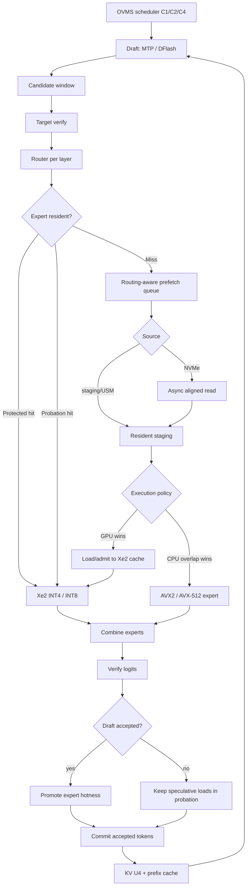

# Горячие и холодные эксперты для Gemma 4, Qwen3.6 и Qwen3.8 на Arc 140V: архитектура кэша и план реализации в OVMS/OpenVINO

> **UMA update (22.10.2026):** [ADR-UMA-01 — физическая LPDDR, zero-copy hypotheses и WDDM/USM gates](ADR-UMA-ARC140V-MEMORY-MODEL-20261022.md). К осям residency/precision hotness добавлена независимая ось **memory-access policy**. Shared physical DRAM на Arc 140V **не гарантирует** CPU/GPU cache coherence, zero-copy или то, что `27.5 GiB GPU memory` является firmware-reserved физической областью. До Windows `UMA-00/01` доказательств обязательный путь — existing verified-read/staging/copy, без замены serving runtime. [Локальный Windows handoff](HANDOFF-UMA-00-WINDOWS-20261022.md).

> **Execution-order revision, 22.10.2026:** [Post-Wave01 / UMA roadmap](POST-WAVE01-UMA-ROADMAP-20261022.md) and [Windows handoff](HANDOFF-ROADMAP-UMA-WAVE01-20261022.md). After actual Wave-01 Windows host acceptance (PR #7), Arc UMA-00 evidence (OVMS #21) and **scratch** path-B G01–G03 / 2-KiB timing (OpenVINO #8), prioritize **CPU scatter / in-flight GPU slot ownership**, then real GEMM bandwidth and C1/C2/C4 before adaptive eviction/prefetch. Early 2-KiB synthetic speedups are NOT full-model gains; `OTD_RESIDENT_USM_HOST` stays default OFF. This updates staging and gate order, not existing model architecture. Linux deferred.

## Резюме

Главный вывод исследования: **для GEMMAMONSTER правильнее моделировать не просто “горячие/холодные слои”, а две независимые оси**:

1. **residency hotness** — какие routed experts должны постоянно жить в доступной Arc 140V памяти;
2. **precision hotness** — какие слои/матрицы нельзя агрессивно квантовать даже тогда, когда они не являются самыми часто вызываемыми.

Strata уже фактически разделяет эти понятия: expert profile ранжирует отдельные `(layer, expert)` по востребованности и адаптирует resident set, тогда как mixed quants сохраняют повышенную точность у отдельных матриц и слоёв. В частности, у Strata для `Qwen3.8-Flash-Next` формат `UD-Q4_K_XL` держит routed `gate/up` в Q4_K, но поднимает layer 2 до Q5_K; `down` обычно Q5_1, однако слои 2, 4, 30, 46 и 47 хранят `down` как Q8_0. Это именно **precision-hot layout**, а не статистика частоты роутинга. fileciteturn13file1L36-L43

Для **Arc 140V / Core Ultra 7 258V с 32 ГБ LPDDR5X-8533** ситуация принципиально отличается от RTX + большая системная RAM: GPU и CPU конкурируют за один физический пул памяти. Поэтому копировать трехъярусную схему `GPU cache → RAM → NVMe` из glm-flash-lite буквально невыгодно. На Lunar Lake лучше стремиться к **одному unified resident expert pool + небольшому staging/prefetch ring + NVMe backing store**, избегая двух полноценных копий одних и тех же экспертов в “VRAM” и RAM. Intel действительно использует в тестовых системах 258V с Arc 140V 32 ГБ LPDDR5-8533. citeturn15search0turn16search9

Для наших трёх моделей вывод получается разным:

| Модель | Роль | Первичная стратегия Arc 140V |
|---|---|---|
| **Gemma 4 26B-A4B** | наш эталон tool-calling / multi-slot | В нормальном INT4 режиме **держать routed experts полностью resident**; NVMe использовать только как pressure valve при длинном C4/MTP |
| **Qwen3.6-35B-A3B** | главный агентный baseline | Тоже стремиться к полному residency; при нехватке памяти переходить к ~75–90% hot resident set, а не сразу к агрессивному streaming |
| **Qwen3.8-Flash-Next** | основной Routed Experts / MTP stress target | Настоящая hot/cold архитектура: fixed dense + MTP resident, несколько тысяч hot experts resident, большая холодная часть на NVMe; PLE/lookup хранить отдельно от expert cache |

В этом отчёте под **Qwen3.8** имеется в виду именно **Qwen3.8-Flash-Next**, то есть MoE-модель, вокруг которой построен текущий Strata. Официальный конфиг Flash-Next задаёт 48 слоёв, 512 routed experts на слой, top-10, один MTP-слой и `ngram_size=3`. citeturn12view2

Ещё один критический вывод касается speculative decoding. **MTP/DFlash не должны пользоваться тем же cache-admission policy, что и окончательно принятые токены.** Verify-window временно активирует экспертов для токенов, которые затем могут быть отвергнуты. Если обычный LRU позволяет таким экспертам вытеснять устойчивый hot set, speculative decoding может ускорить вычисления и одновременно разрушить expert-cache. Текущий OpenVINO использует LRU в `OffloadExpertWeightProvider`, поэтому именно здесь появляется наиболее очевидная точка улучшения. fileciteturn10file1L26-L27 fileciteturn12file0L1-L13

**Практическая рекомендуемая последовательность для GEMMAMONSTER**:

**сначала** trace instrumentation существующего OpenVINO OTD → **потом** offline cache replay → **затем** speculation-aware 2Q/CLOCK cache → **затем** async prefetch/prepacked expert store → и только после этого CPU-expert execution и специализированные Xe2 kernels.

Так мы не будем переписывать работающий OTD вслепую.

## Что действительно стоит перенести из Strata, glm-flash-lite и DeepSeek-Flash

Strata, glm-flash-lite и DeepSeek-style SSD streaming решают одну проблему, но делают это по-разному. Для Arc 140V нам нужен гибрид их идей.

**Strata** прежде всего интересен не как “SSD inference engine”, а как пример **адаптивной expert residency**. В нормальном режиме Strata держит большую часть expert arena в RAM и наиболее востребованные experts на GPU; в low-RAM режиме он умеет mmap'ить `experts.bin`, использовать RAM-budget только для самых горячих экспертов и оставлять хвост на файловом tier. Его adaptive tier использует decayed routing counts, умеет переставлять горячие experts между tiers и сохранять learned expert profiles между запусками. citeturn20search0

Особенно полезна идея Strata, что **кэш — это не фиксированный список слоёв**. Профилируется конкретная пара `(layer_id, expert_id)`. Это намного лучше схемы “слои 0–15 горячие, остальные холодные”: в каждом MoE-слое есть свой long tail, а отдельные эксперты могут стабильно доминировать на agent/tool workload. Strata также оставляет GPU memory под routers, shared experts, attention, MTP и KV, а свободный остаток отдаёт adaptive expert cache. citeturn20search0

Второй урок Strata — **mixed quantization должна следовать sensitivity, а не residency**. Для Qwen3.8 Strata документирует реальные размеры routed expert pool: 55.4 GiB для `UD-IQ4_XS`, 71.7 GiB для `UD-Q4_K_XL` и 119.5 GiB для Q8_0. У `UD-Q4_K_XL` один target-token проход через 10 экспертов × 48 слоёв соответствует примерно 1.50 GB routed-weight traffic до учёта кэша. В том же пакете attention, shared experts и другие dense projections остаются Q8_0, а PLE-таблица в более компактных вариантах имеет размер около 26.8 GiB. fileciteturn15file0L2-L2

Это важно для Arc 140V: **Qwen3.8 PLE нельзя трактовать как обычный resident weight blob**. Это большой lookup-oriented объект. Для него нужен отдельный file-backed/row-cache путь, а не expert LRU. Смешивание PLE и routed experts в одном eviction domain гарантированно ухудшит обе стороны. Размер и структура PLE в Strata подтверждают такое разделение. fileciteturn15file0L2-L2

**glm-flash-lite** значительно ближе к нашей NVMe-задаче. Его GLM-5.3-Flash содержит 12 096 routed experts, а runtime делит их между GPU hot cache, pinned-RAM tier и NVMe store. В опубликованной конфигурации около 1 300 hottest experts находятся в VRAM; RAM и VRAM не дублируют друг друга; cold experts могут вычисляться AVX2 CPU lane одновременно с GPU; NVMe records имеют 4K-alignment; layer-ahead prefetch запускает чтение экспертов следующего слоя заранее. Авторы сообщают, что prefetch уменьшил demand misses примерно с 40 до 22 на токен в соответствующем эксперименте. citeturn13search0turn13search2

glm-flash-lite также показывает, почему **hit-rate сам по себе недостаточен**. В их C1-профиле порядка 120 expert picks попадают в GPU, около 175 обслуживаются RAM и примерно 23 идут до NVMe; CPU lane и GPU lane работают параллельно. То есть реальный KPI — не `cache_hit_rate`, а **bytes from NVMe per accepted token + exposed wait time**. citeturn13search0

Для Arc 140V из glm-flash-lite я бы переносил:

| Идея | Переносим? | Как адаптировать к 258V |
|---|---:|---|
| Hot expert ranking | **Да** | `(layer, expert)` EMA/decayed counters |
| CLOCK / adaptive eviction | **Да** | вместо чистого LRU |
| Layer-ahead routing/prefetch | **Да** | в OpenVINO GPU MoE path |
| 4K-aligned packed expert store | **Да** | expert-major record |
| CPU cold-expert lane | **Да, экспериментально** | только misses; следить за shared LPDDR bandwidth |
| Отдельный огромный RAM tier | **Нет** | у 258V это та же физическая 32-GB LPDDR |
| Duplicate GPU+RAM expert copies | **Нет** | стремиться к shared/USM representation |
| O_DIRECT всегда | **Не сразу** | сначала correctness на штатном mmap/OTD |

**DeepSeek/DS4** подтверждает ещё одну полезную архитектуру: current SSD-streaming implementations постепенно пришли к иерархии VRAM cache → pinned host cache → SSD, потому что отсутствие промежуточного reuse приводило к повторному чтению одних и тех же routed experts с SSD. В CUDA-ветке ds4 был добавлен host cache именно для того, чтобы SSD не перечитывал recurrent experts при каждом decode step. citeturn14search0turn14search2

На 258V мы должны взять от этого не сами уровни памяти, а **принцип “disk is backing store, not working set”**. На интегрированной Arc рабочим кэшем должна быть единая LPDDR, а NVMe должен видеть только истинный cold tail.

Наконец, upstream OpenVINO уже предоставляет правильную стартовую точку. В релизах 2026 года GPU plugin получил MoE disk offload; `OFFLOAD_RATIO` задаёт процент eligible MoE weights, обслуживаемых on-demand через LRU. citeturn17search1turn17search3 В текущем коде `OffloadExpertWeightProvider` различает hit/miss, получает LRU slot и при miss вызывает `fill_weights_memory`; последний читает gate/up/down weights, scales и zero points и затем копирует их в resident memory. Для scales/ZP на пути загрузки выполняется transpose, включая unpack→transpose→repack для U4 zero points. fileciteturn12file0L1-L13 fileciteturn11file0L1-L10

Это означает, что **первый GEMMAMONSTER prototype должен расширять существующий OpenVINO OTD, а не заменять его новым inference engine**.

## Раскладка моделей: слои, эксперты, размеры и hot/cold tiers

Все расчёты ниже используют **KV U4 как установленный baseline GEMMAMONSTER**. KV-cache не включён в размер expert pool: перед назначением expert budget runtime должен сначала вычесть фактический U4 KV footprint, model-fixed weights, MTP/drafter, activations и safety reserve.

Для размера routed expert используется минимальная модель:

\[
S_{expert} = 3 \times H \times I_{moe} \times bits/8
\]

где три матрицы — `gate`, `up`, `down`. Это **raw weight size**; OpenVINO scales/ZP, alignment и metadata несколько увеличат реальный record, поэтому для I/O-модели ниже добавлен 5% инженерный запас. Параметры H, `moe_intermediate_size`, количество слоёв и experts взяты из официальных конфигураций моделей. citeturn12view0turn12view1turn12view2

| Модель | MoE слои | Experts / слой | Active / токен | Raw INT4 expert | Всего routed expert instances | Raw routed INT4 |
|---|---:|---:|---:|---:|---:|---:|
| **Gemma 4 26B-A4B** | 30 | 128 | 8 | **2.836 MiB** | 3 840 | **10.63 GiB** |
| **Qwen3.6-35B-A3B** | 40 | 256 | 8 | **1.500 MiB** | 10 240 | **15.00 GiB** |
| **Qwen3.8-Flash-Next** | 48 | 512 | 10 | **2.344 MiB** | 24 576 | **56.25 GiB** |

У Gemma 4 официальный model card указывает 30 слоёв, 128 experts, восемь активных и один shared expert; архитектура чередует пять sliding-attention слоёв и один global. Global attention приходится на `L5, L11, L17, L23, L29` при нумерации с нуля. citeturn12view1turn19view0

**Рекомендуемая Gemma 4 раскладка:**

| Tier | Содержимое | Рекомендация |
|---|---|---|
| Fixed-hot | embedding/head, routers, norms, attention, shared experts | Всегда resident |
| E0-hot | routed experts L0–L29 | **Все 128/слой resident**, когда позволяет C4/KV |
| E1-pressure | top **96/128** experts каждого слоя | ~7.98 GiB raw INT4 |
| E2-cold | оставшиеся 32/слой | NVMe только при memory pressure |
| Precision guard | L0 и L29 как стартовая гипотеза | INT8/BF16 A/B, не считать доказанной необходимостью |

То есть для Gemma я **не делал бы NVMe основной архитектурой**. Весь raw INT4 routed pool — всего около 10.6 GiB. Учитывая, что сама Gemma 4 26B-A4B имеет 25.2B total и 3.8B active parameters, модель как раз относится к классу, где Arc 140V может выиграть больше от сохранения полного expert residency и U4 KV, чем от постоянного disk streaming. citeturn19view0

NVMe для Gemma нужен как **elastic overflow**: например, C4 + длинные контексты + MTP assistant начинают вытеснять expert cache, тогда cache shrink идёт 128 → 112 → 96 experts/layer. Это значительно безопаснее фиксированного высокого `OFFLOAD_RATIO`.

Qwen3.6 имеет 40 text layers, 256 experts на слой, top-8, `moe_intermediate_size=512`, один MTP-layer и full attention каждый четвёртый слой. Поэтому full-attention layers: `L3, L7, L11, L15, L19, L23, L27, L31, L35, L39`; остальные 30 используют linear attention. citeturn12view0

**Рекомендуемая Qwen3.6 раскладка:**

| Tier | Содержимое | Рекомендация |
|---|---|---|
| Fixed-hot | attention/GDN, routers, shared experts, embedding/head | Resident |
| Draft-hot | native MTP weights | **Отдельный resident allocation**, не expert LRU |
| E0-hot | если память позволяет | все 256 experts/layer = 15 GiB raw |
| E1-pressure | top **192/256** / layer | ~11.25 GiB |
| E2-cold | оставшиеся 64 / layer | NVMe |
| Adaptive surplus | slots сверх minimum floor | раздавать по global `(layer, expert)` score |

Это для нас, вероятно, **самый важный реальный production target**. Он достаточно мал, чтобы почти весь expert pool держать в LPDDR, но достаточно большой, чтобы длинный context, C4 и speculative state могли создать давление. Поэтому именно Qwen3.6 хорош для отладки elastic hot/cold cache без экстремального I/O Qwen3.8.

В OpenVINO уже есть прямое наблюдение этой проблемы: в текущем issue по Qwen3.6 автор получил около 88% acceptance при одном assistant token и около 66% при трёх; maintainer отдельно отметил, что speculative pass MoE активирует больше experts и тем самым повышает computation и memory transfer при offload. Эти проценты — конкретный пользовательский эксперимент, а не универсальные характеристики Qwen3.6. citeturn17search5

Qwen3.8-Flash-Next — другой класс. Он имеет 48 layers, 512 experts/layer, top-10, `moe_intermediate_size=640`, один native MTP-layer, PLE на layer 2 и `ngram_size=3`; full attention снова идёт каждый четвёртый слой: `L3, L7, ... L47`. citeturn12view2

Здесь Strata уже даёт очень хороший **precision seed**:

| Qwen3.8 компонент | Strata UD-Q4_K_XL |
|---|---|
| routed `gate/up`, обычно | Q4_K |
| `gate/up` layer 2 | **Q5_K** |
| routed `down`, обычно | Q5_1 |
| `down` L2, L4, L30, L46, L47 | **Q8_0** |
| attention/shared/dense | преимущественно Q8_0 |
| PLE table | IQ4_NL |
| routers | F32 |

Это непосредственно следует из Strata/Unsloth pack analysis. fileciteturn13file1L36-L43 fileciteturn15file0L2-L2

Для GEMMAMONSTER я бы перенёс **идею**, но не обязательно форматы один в один:

**INT4 base expert → selectively INT8 `down` → BF16 только для тех узлов, где INT8 не проходит quality gate.**

Для Xe2 это гораздо естественнее, чем держать большие BF16 islands.

У Qwen3.8 resident layout должен быть уже настоящим Strata-подобным:

| Tier | Qwen3.8 |
|---|---|
| Fixed-hot | dense path, router, shared expert, head, native MTP |
| PLE tier | отдельный NVMe/mmap row-store, **не expert cache** |
| Per-layer floor | 32 hot experts × 48 = 1 536 slots |
| Adaptive pool | ещё ~3 072 slots по global hotness |
| Initial total | **≈4 608 resident experts**, то есть 96/layer в среднем |
| Cold tail | ≈19 968 experts на NVMe |
| Precision-hot | L2, L4, L30, L46, L47 — стартовый seed из Strata, далее наша sensitivity calibration |

Если использовать реальный Strata `UD-Q4_K_XL`, routed pool составляет 71.7 GiB, то есть примерно **2.99 MiB на expert instance**; 4 608 таких slots требуют около **13.4 GiB**. Более агрессивный `UD-IQ4_XS` даёт около 2.31 MiB/expert и уменьшает тот же cache примерно до 10.4 GiB, но Strata показывает заметно более сильную quality degradation у более агрессивных quants, поэтому низкую разрядность нельзя выбирать только по размеру. fileciteturn15file0L2-L2

Главное отличие нашей схемы от простого `96 experts/layer`: это только **initial budget**. Реальный allocator должен иметь minimum floor на каждом слое, а оставшиеся slots распределять глобально:

\[
score(l,e)=EMA(accesses_{l,e})\times miss\_cost_{l,e}\times speculation\_weight
\]

Так слой с очень сконцентрированным router distribution не забирает лишнюю память, а слой с широким tail автоматически получает больше slots.

## Моделирование кэша, MTP/DFlash и NVMe traffic

Здесь важно отделить **измеренные факты** от **синтетической модели**.

У нас пока нет production routing traces именно GEMMAMONSTER для этих трёх моделей. Поэтому я построил начальную replay-модель, которую надо заменить реальными traces уже на первом этапе реализации.

Синтетический профиль откалиброван приблизительно по glm-flash-lite: там GPU cache размером около 1 300 из 12 096 experts покрывает примерно 38–39% C1 expert accesses, что указывает на заметно skewed routing distribution. citeturn13search0turn13search2 Для модели использовано Zipf-подобное распределение с `α≈0.63`, 40% temporal reuse предыдущего token expert-set и 75/25 смесь общего и slot-specific профиля.

Это **не прогноз фактического hit-rate моделей**, а инструмент для оценки архитектурных эффектов.

Резидентные размеры simulation:

| Модель | Resident cache в simulation |
|---|---:|
| Gemma 4 | 96 / 128 experts/layer = 75% |
| Qwen3.6 | 192 / 256 = 75% |
| Qwen3.8 | 96 / 512 = 18.75% |

Получившийся LRU hit-rate:

| Модель | C1 plain | C2 plain | C4 plain | C1 MTP | C4 MTP |
|---|---:|---:|---:|---:|---:|
| Gemma 4 | 89.2% | 88.7% | 88.2% | 89.3% | 88.5% |
| Qwen3.6 | 89.3% | 89.1% | 88.6% | 89.7% | 89.0% |
| Qwen3.8 | 57.6% | 56.9% | 56.6% | 57.5% | 56.6% |

Сам по себе speculative verify в этой модели почти не разрушает hit-rate. **Проблема в другом: один verify pass требует гораздо больше target expert accesses.**

Для MTP simulation использован verify window `W=4`: до трёх drafted positions плюс target verification/correction. Это согласуется с нашим practical target `draft-n-max≈3`; для Gemma 4 Google официально выпускает отдельный 0.4B MTP assistant и описывает parallel target verification, а Qwen3.6 и Qwen3.8 имеют MTP support в архитектуре. citeturn19view0turn12view0turn12view2

Для Qwen3.6 DFlash использован отдельный stress-case `W=11`, поскольку опубликованный AEON recipe использует DFlash `n=11`. Для этого drafter авторы сообщают около 46–55% acceptance на structured workloads и существенно более низкую acceptance на creative text; это снова hardware/workload-specific данные DGX Spark, не прогноз Arc 140V. citeturn11view3

Полезная формула:

\[
NVMeBytes/accepted =
\frac{L\times K\times W\times(1-hit)\times S_{expert}}
{accepted\_tokens\_per\_verify}
\]

Для I/O-модели я использовал raw INT4 expert size + 5% на scales/ZP/alignment. Для MTP приняты рабочие simulation values: Gemma 2.5 accepted tokens/pass, Qwen3.6 3.0, Qwen3.8 2.8. Для DFlash — 6.5 accepted/verify в центральном stress scenario. Эти acceptance values **являются параметрами simulation, не измерениями моделей на Arc**.

Результат для прогретого LRU:

| Модель / режим | C1 NVMe MiB / accepted token | C4 | I/O floor C1 при условных 5 GiB/s |
|---|---:|---:|---:|
| Gemma plain, pressure-cache | ~77 | ~84 | ~15 ms |
| Gemma MTP | ~123 | ~135 | ~24 ms |
| Qwen3.6 plain, pressure-cache | ~54 | ~57 | ~11 ms |
| Qwen3.6 MTP | ~72 | ~77 | ~14 ms |
| Qwen3.6 DFlash n=11 | ~91 | ~97 | ~18 ms |
| Qwen3.8 plain | **~501** | **~513** | **~98 ms** |
| Qwen3.8 MTP | **~716** | **~732** | **~140 ms** |

`5 GiB/s` здесь не характеристика вашего SSD, а только единая точка сравнения. На реальной машине benchmark должен измерить random/aligned read throughput именно при record-size наших experts и реальной queue depth.

Картина cold-cache ещё нагляднее. При 0% hits один обычный target token потребовал бы приблизительно:

| Модель | Cold routed reads / token | I/O floor @ 5 GiB/s |
|---|---:|---:|
| Gemma 4 | ~715 MiB | ~140 ms |
| Qwen3.6 | ~504 MiB | ~98 ms |
| Qwen3.8 | ~1 181 MiB | ~231 ms |

Это объясняет, почему **“просто грузить top-k с NVMe каждый token” не является жизнеспособной архитектурой**. Disk offload становится быстрым только после того, как SSD перестаёт быть primary working set.

И одновременно таблица показывает важную разницу наших моделей.

Для **Gemma 4** и **Qwen3.6** настоящий production warm state должен стремиться не к simulated 89% hit, а к **почти 100% residency**, потому что весь INT4 routed pool сам по себе занимает только ~10.6 и 15 GiB. Тогда NVMe traffic на decode фактически исчезает, кроме редких memory-pressure transitions.

Для **Qwen3.8** 96/512 cache даже при skewed routing недостаточен в synthetic model. Здесь нужны одновременно:

**более агрессивный expert quant + adaptive global residency + 2Q admission + prefetch + возможно CPU lane.**

И здесь speculative decoding требует отдельной политики. Я предлагаю разделить cache state на:

| State | Что происходит |
|---|---|
| `PROTECTED` | доказанно горячий expert; speculative miss не может сразу его вытеснить |
| `PROBATION` | expert появился впервые или только в speculative verify |
| `PREFETCHED` | bytes уже читаются/прочитаны, но expert ещё не получил cache residency |
| `COMMITTED` | expert использован accepted output; повышаем hotness |
| `VICTIM` | недавно вытеснен, короткий reuse window |

Это фактически **2Q + speculation awareness**.

Обычный LRU не различает “expert был нужен одному отвергнутому draft token” и “expert используется уже сотни accepted tokens”. Поэтому MTP/DFlash burst способен размыть steady-state working set.

Рекомендованный порядок cache policies для A/B:

| Policy | Роль |
|---|---|
| **LRU** | обязательный control, текущий OpenVINO |
| **CLOCK** | дешёвый близкий к LRU вариант; glm-flash-lite уже использует CLOCK-like cache |
| **2Q / SLRU** | основной кандидат для multi-slot/speculative |
| **Routing-aware 2Q** | конечный кандидат: EMA profile + probation + next-layer prefetch |
| Pure LFU | не рекомендую первым | плохо адаптируется к смене проекта/разговора без decay |

Самое важное правило: **prefetch не должен автоматически означать admission**. Можно заранее прочитать expert для speculative window, использовать его один раз и выбросить, не вытеснив protected cache line.

## Реализация в OpenVINO/OVMS, CPU experts и Xe2

Upstream OpenVINO уже имеет нужную архитектурную границу. `OffloadExpertWeightProvider` хранит LRU, `try_acquire_simultaneous()` дедуплицирует одновременно требуемых experts, а на miss `fill_weights_memory()` читает веса и заполняет cache slot. fileciteturn12file0L1-L13

Следовательно, первый серьёзный patch должен быть **не в OVMS scheduler**, а здесь:

```text
OpenVINO Intel GPU plugin
    MoE primitive
        |
        +-- IExpertWeightProvider
                |
                +-- ResidentExpertWeightProvider
                |
                +-- OffloadExpertWeightProvider
                         |
                         +-- ResidencyPolicy
                         +-- AsyncExpertLoader
                         +-- ExpertStore
                         +-- RouteProfiler
```

OVMS остаётся orchestration layer: C1/C2/C4 scheduling, prefix cache, KV U4, model lifecycle, metrics. Expert paging принадлежит GPU plugin.

При этом уже сегодня OTD instrumentation умеет считать GPU hits/misses, disk I/O, transpose, GPU copy и fallbacks через `MOE_OTD_PERF_LOG`. Код отдельно замеряет disk read, transpose и GPU copy. fileciteturn11file0L1-L10

Это практически готовая основа для Phase A.

Дальше нужен **prepacked ExpertMajor store**. Сейчас OpenVINO serialized MoE path читает `gate_w`, `up_w`, `down_w`, затем scales и zero-points; scale/ZP могут дополнительно транспонироваться на каждом miss. Для U4 zero-points код делает unpack → transpose → repack. fileciteturn11file0L1-L10

Для NVMe это лишняя работа в critical path.

Я предлагаю offline packer:

```text
expert-store/
    manifest.bin
    layer-000.bin
    layer-001.bin
    ...
```

а внутри каждого expert record:

```text
[header]
[gate_w native-GPU-layout]
[up_w   native-GPU-layout]
[down_w native-GPU-layout]
[gate_s pre-transposed]
[up_s   pre-transposed]
[down_s pre-transposed]
[zero-points prepacked]
[padding to 4 KiB]
```

Тогда miss становится:

```text
one/coalesced pread -> staging ring -> GPU/USM slot
```

вместо серии reads + host transformations.

Для Arc 140V нужно обязательно A/B проверить **device allocation против shared USM/host-visible allocation**. В отличие от discrete GPU, Lunar Lake имеет общую LPDDR; дополнительная логическая memcpy может не означать физический PCIe transfer, но всё равно может создавать synchronization и bandwidth overhead. Intel Xe2 Lunar Lake содержит восемь Xe-cores, а XMX поддерживает FP16/BF16, INT8 и INT4/INT2. Intel публикует следующие peak rates на Xe-core: 2048 ops/clock для XMX FP16/BF16, 4096 для INT8 и 8192 для INT4/INT2. citeturn21view0turn22view0

Поэтому answer на вопрос “что любит 140V — INT, FP или BF?” уже можно сузить:

| Формат | Xe2 peak | Что тестировать |
|---|---:|---|
| BF16 / FP16 | 2048 ops/clock | quality/reference path |
| INT8 | 4096 | precision-hot down projections |
| **INT4** | **8192** | главный routed-expert кандидат |
| INT2 | 8192 | только research; quality риск намного выше |

Но этот hardware peak **не доказывает**, что INT4 всегда выиграет decode. При `batch=1` MoE GEMV может быть memory-bound; unpack/dequant и маленькие матрицы могут не загрузить XMX. MTP verify, наоборот, даёт несколько columns/tokens сразу и способен значительно лучше использовать matrix hardware. Поэтому наш Xe2 benchmark должен отдельно измерять `M=1`, `M=2`, `M=4`, `M=8/11`, а не только большой GEMM. Поддерживаемые XMX форматы и peak throughput подтверждаются Intel. citeturn21view0turn22view0

Практически я бы ставил такой порядок kernel research:

**INT4 weights → XMX INT4**,  
**INT4 storage → INT8 compute/dequant**,  
**INT8 weights/XMX INT8**,  
**BF16**,  
**FP16**.

И смотреть не только tok/s, а `ns / expert / token-column`, DRAM bytes, occupancy и numerical delta.

CPU experts — отдельный, но очень перспективный lane.

glm-flash-lite уже требует `AVX2 + FMA + F16C` и вычисляет cold RAM experts CPU-потоками параллельно GPU. citeturn13search0turn13search4 Strata в своих K-quant benchmarks показывает, что Ryzen 5600X на single-token expert GEMV способен доходить практически до RAM-bandwidth bound; при нескольких tokens эффективность зависит от quant format и специализированного multi-token kernel. fileciteturn15file0L2-L2

Это очень хороший знак для **старых Ryzen AVX2**: для decode нужна не обязательно огромная FLOPS-мощность, а эффективный quantized GEMV, который читает expert один раз и делает минимум преобразований.

Для нашего **2× Xeon Gold 6242** ситуация ещё интереснее. Каждый 6242 имеет 16 cores / 32 threads, шесть каналов DDR4-2933, AVX2, AVX-512, два AVX-512 FMA units и Intel DL Boost. citeturn16search8turn15search3 Это Cascade Lake, поэтому здесь стоит целиться прежде всего в **AVX-512/VNNI INT8 и packed Q4→INT8 kernels**, а не строить CPU path вокруг BF16/AMX.

На dual-socket 6242 я бы физически partitioned expert cache по NUMA:

```text
NVMe
 |
 +--> NUMA0 hot/cold staging --> CPU0 expert workers
 |
 +--> NUMA1 hot/cold staging --> CPU1 expert workers
```

и **не разрешал worker socket 0 регулярно читать expert blob из socket 1**. При двух сокетах remote NUMA traffic способен уничтожить преимущество дополнительной памяти.

На **258V** CPU lane нужно использовать осторожнее. В RTX-системе glm CPU читает DDR, пока GPU читает отдельную VRAM. В Lunar Lake CPU и Arc 140V читают одну LPDDR5X. Поэтому большой CPU expert pool может непосредственно отнимать bandwidth у Xe2.

Для 258V правильная политика:

```text
GPU hot experts       -> всегда Xe2
warm miss, already RAM-> benchmark CPU vs GPU
NVMe cold miss        -> CPU candidate only if overlap beats GPU staging
```

а не “30% experts всегда CPU”.

Самый интересный вариант — **CPU executes a cold expert directly from the NVMe staging buffer**, пока Xe2 считает hot experts того же MoE layer. Именно эту математику стоит портировать из glm/Strata.

При этом результаты суммируются перед shared expert/residual:



Ещё одна current OpenVINO оговорка: offload пока молодой. Есть зарегистрированный Arc 140V issue, где OTD выдаёт NaN при чтении IR с отключённым mmap; с mmap по умолчанию проблема в том reproducer не возникала. Поэтому **первый GEMMAMONSTER branch не должен отключать mmap**. citeturn17search2 Есть также текущие reports по `OFFLOAD_RATIO` и repeated generate, поэтому offload branch должен быть pinned к конкретному OpenVINO commit, а не автоматически ехать за master. citeturn17search0

## План внедрения и критерии принятия

Я бы теперь разделил реализацию на шесть небольших, проверяемых стадий. До третьей стадии мы **вообще не меняем математику inference**.

| Стадия | Что делаем | Что является результатом |
|---|---|---|
| **Trace** | Расширяем OTD counters до `(request, slot, token, layer, expert, hit/miss, load_bytes, load_us)` | реальные routing traces Gemma/Q36/Q38 |
| **Replay** | Offline simulator LRU/CLOCK/2Q/spec-aware | policy выбирается без риска runtime |
| **Policy** | `ResidencyPolicy` за `IExpertWeightProvider` | LRU остаётся control, новая policy переключаема |
| **I/O** | prepacked ExpertMajor + async read + prefetch ring | уменьшаем miss latency |
| **Hybrid** | CPU experts + Xe2 format experiments | overlap cold CPU/hot GPU |
| **Integration** | OVMS C1/C2/C4 + MTP/DFlash + tool workload | candidate GEMMAMONSTER build |

Первый trace должен содержать **accepted/rejected speculative status**. Без этого невозможно построить speculation-aware cache: обычные route counts будут считать отвергнутые DFlash/MTP candidates столь же важными, как реально выданные токены.

Для каждого expert я бы собирал:

```text
model_id
request_id
slot_id
decode_step
verify_window_id
candidate_position
accepted
layer_id
expert_id
router_rank
router_weight
resident_before
cache_state
prefetched
source = resident|staging|nvme
bytes_read
io_us
copy_us
compute_device = GPU|CPU
compute_us
```

А уже offline считать:

```text
access_frequency
accepted_frequency
speculative_only_frequency
reuse_distance
inter-token reuse
inter-window reuse
C1/C2/C4 interference
layer miss entropy
NVMe bytes / accepted token
```

**Это и даст настоящую hot/cold раскладку.** Сейчас любые фиксированные списки experts были бы гаданием.

Для cache allocation предлагаю стартовую формулу:

\[
score =
EMA(accepted\_hits)
+0.25\cdot EMA(speculative\_hits)
+\lambda\cdot miss\_latency
\]

То есть speculative route влияет на prediction, но имеет гораздо меньший вес при защите residency.

Для отдельных моделей acceptance gates должны быть разными.

| Gate | Gemma 4 | Qwen3.6 | Qwen3.8 |
|---|---|---|---|
| KV | **U4** | **U4** | **U4** |
| Shared experts | 100% resident | 100% resident | 100% resident |
| Draft/MTP | resident | resident | resident |
| Desired routed residency | ~100% | ~100%, ≥75% under pressure | adaptive, начально ~4.6k slots |
| Warm NVMe traffic | ≈0 normally | `<64 MiB/accepted token` target | `<250–300 MiB/accepted token` initial gate |
| C4 cache degradation | <5 pp vs C1 | <5 pp | <10 pp |
| MTP benefit | ≥15% accepted tok/s | ≥15% | ≥15% |
| Speculation I/O penalty | ≤25% bytes/accepted | ≤25% | ≤25% после policy tuning |
| Cache policy | не хуже LRU | 2Q ≥ LRU | routing-aware 2Q должен обогнать LRU |
| Correctness | current GEMMAMONSTER tool suite | agent/tool suite | Qwen3.8 reasoning/agent suite |

Для **Gemma 4** самым важным acceptance test остаётся не синтетический benchmark, а то, что уже делает её ценным baseline: tool calls, parallel calls и C1/C2/C4 OVMS behavior. Официальная Gemma 4 сама имеет native function-calling и отдельный MTP assistant; наш runtime optimization не должен ломать эти свойства. citeturn19view0

Для **Qwen3.6** главным тестом становится агентный loop:

```text
prefix cache
→ tool call
→ tool response append
→ continued generation
→ second/third tool call
```

при C1/C2/C4 и трёх decode modes:

```text
plain
native MTP
DFlash
```

DFlash особенно полезен как cache stress-test, потому что его `n=11` создаёт существенно более широкий speculative target window. Опубликованный Qwen3.6 DFlash drafter является 8-layer full-attention model и демонстрирует, что acceptance остаётся значимой на длинном context на исходной NVIDIA-платформе; для нас это не performance обещание, а основание включить его в test matrix. citeturn11view3

Для **Qwen3.8** я бы поставил жёсткий early gate: если после 256 warm-up tokens C1 resident cache не достигает хотя бы примерно **70–80% expert-access hits**, а NVMe traffic остаётся выше ~300 MiB на accepted token, **не оптимизировать scheduler дальше**. Сначала уменьшить expert footprint, улучшить ranking или добавить CPU/shared-memory tier. Иначе одиночный NVMe физически останется главным bottleneck.

Отдельно должен существовать **Xe2 precision benchmark**, потому что аппаратно Arc 140V выглядит очень благоприятно для INT4, но только измерение ответит, где находится фактический optimum:

| Test | Обязательно |
|---|---|
| expert GEMV/GEMM INT4 | M=1,2,4,8,11 |
| INT8 | те же shapes |
| BF16 | те же shapes |
| FP16 | те же shapes |
| gate/up отдельно от down | да |
| cold cache / warm cache | да |
| compute + dequant | да |
| pure kernel отдельно | да |
| MTP verify-window | да |
| C1/C2/C4 | да |

Intel Xe2 даёт INT4 в четыре раза больший nominal XMX ops/clock, чем BF16/FP16, но реальный MoE decode может быть ограничен памятью и launch overhead; поэтому выбор формата должен происходить по **end-to-end TPOT**, а не по теоретическому TOPS. citeturn21view0turn22view0

И наконец, я бы уже сейчас зафиксировал архитектурный принцип будущего кода GEMMAMONSTER:

> **KV U4 освобождает память. Fixed weights и draft/MTP получают гарантированную residency. Routed experts используют adaptive, speculation-aware cache. NVMe хранит cold tail. CPU участвует только там, где его работа действительно перекрывает disk/GPU stall.**

Это хорошо ложится и на наши три разные модели:

**Gemma 4** проверяет, что новый механизм ничего не ломает в хорошо отлаженном OVMS multi-slot/tool runtime.

**Qwen3.6** является главным production benchmark для agentic inference и показывает, умеем ли мы совместить MTP/DFlash, prefix cache, U4 KV и adaptive expert residency без регрессии.

**Qwen3.8-Flash-Next** является настоящим stress-test архитектуры: 24 576 routed expert instances, native MTP, отдельная большая PLE structure и mixed-precision experts. Именно на нём станет ясно, удалось ли превратить OpenVINO `OFFLOAD_RATIO + LRU` в полноценный **Routed Expert Memory Manager**, а не просто научиться читать веса с SSD. citeturn12view2
